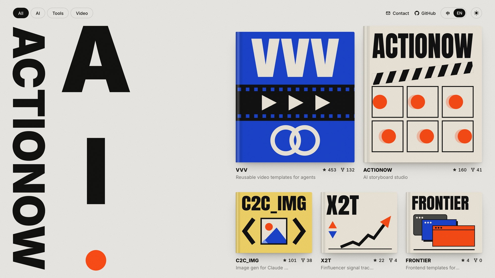
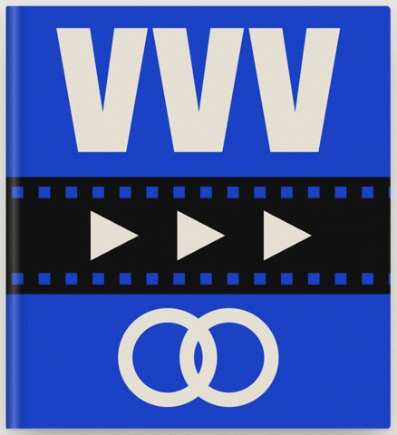
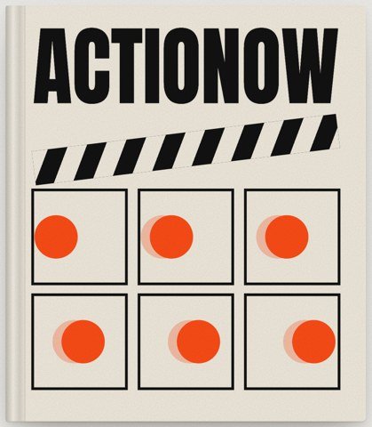
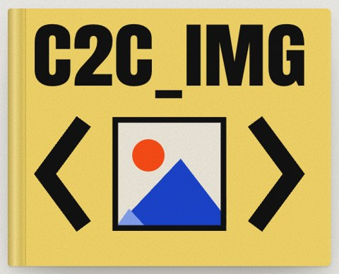
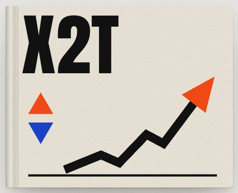
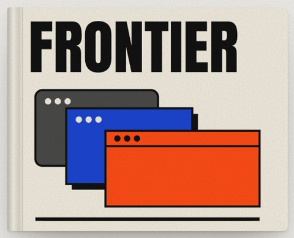

<a href="https://actionow.ai">
  <picture>
    <source media="(prefers-color-scheme: dark)" srcset="assets/shelf-dark.jpg">
    
  </picture>
</a>

<h3 align="center">Open-source tools for AI-native creators</h3>

给 AI 时代创作者的开源工具 · 每个项目都是书架上的一本书

  <a href="https://actionow.ai"><b>actionow.ai</b></a> ·
  <a href="mailto:actionow.ai@gmail.com">Contact</a>

 

<table>
  <tr>
    <td width="150" align="center"></td>
    <td>
      <b><a href="https://github.com/actionow-ai/vvv">VVV</a></b> — Reusable video templates for agents 
      Build a video template once, reuse it across Claude Code, Codex and 25+ coding agents. 
      一次构建视频模板，在各家编程 Agent 里反复复用。  
      
      
    </td>
  </tr>
  <tr>
    <td align="center"></td>
    <td>
      <b><a href="https://github.com/actionow-ai/actionow">Actionow</a></b> — AI storyboard studio 
      The open-source, agent-driven studio for screenwriting and storyboard production. Self-hostable. 
      开源 AI 影视创作工作台：从剧本到分镜，从角色到成片。  
      
    </td>
  </tr>
  <tr>
    <td align="center"></td>
    <td>
      <b><a href="https://github.com/actionow-ai/c2c_img">c2c_img</a></b> — Image generation for Claude Code 
      Native-feeling image generation and editing in Claude Code, powered by your local Codex. No API key. 
      让 Claude Code 像原生一样生图、改图，由本地 Codex 驱动，无需 API Key。  
      
    </td>
  </tr>
  <tr>
    <td align="center"></td>
    <td>
      <b><a href="https://github.com/actionow-ai/x2t">X2T</a></b> — Finfluencer signal tracker 
      Turns finfluencer posts into bullish / bearish calls per ticker, then scores them against the market. 
      把财经博主的喊单变成可追踪的战绩：AI 标立场 · 记转向 · 回测跑赢大盘。  
      
      
    </td>
  </tr>
  <tr>
    <td align="center"></td>
    <td>
      <b><a href="https://github.com/actionow-ai/frontier">Frontier</a></b> — Front-end templates for agents 
      Proven design systems packaged for AI agents to copy, customise and verify. No npm package. 
      把验证过的前端设计体系抽成可复用资产，供 AI Agent 复制、定制、验收。  
      
      
    </td>
  </tr>
</table>

Open a book at <a href="https://actionow.ai">actionow.ai</a>

